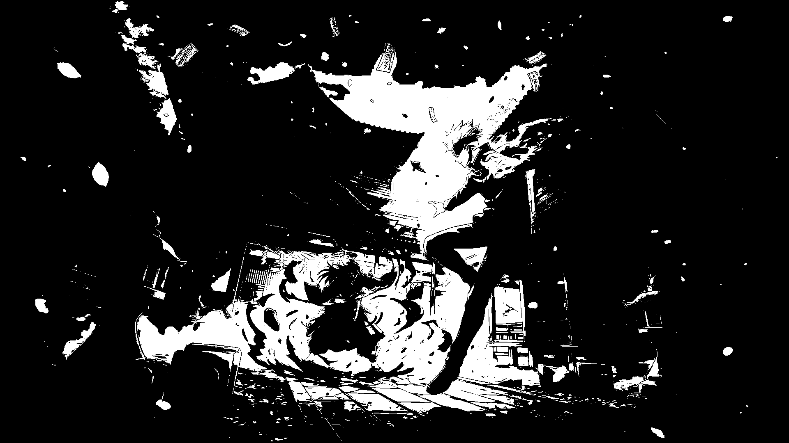
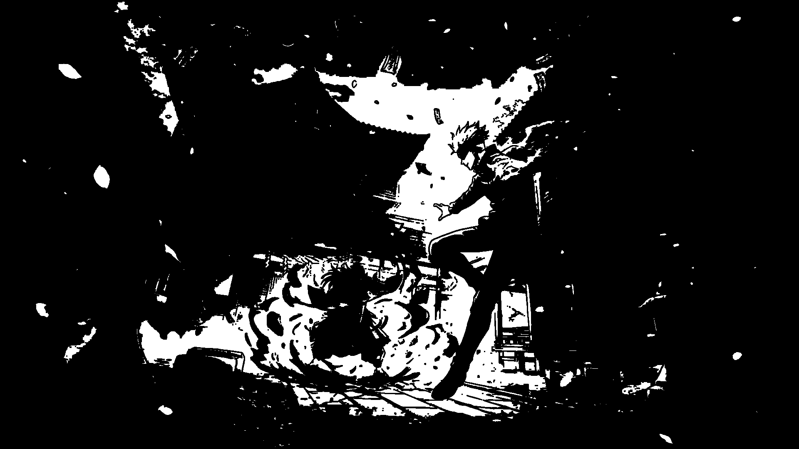

# Системы компьютерной обработки изображений 1

**Вариант:** 7 – Эрозия, примитив размера 3 на 3, бинаризацию можно не реализовывать вручную

**Выполнил:**
Силинцев Владислав Витальевич

****Преподаватель:****
Денисов Алексей Константинович

## Цель работы

Научиться реализовывать один из простых алгоритмов обработки
изображений.

## Задание

1. Реализовать программу согласно варианту задания. Базовый алгоритм,
   используемый в программе, необходимо реализовать в 2 вариантах: с
   использованием встроенных функций какой-либо библиотеки (OpenCV,
   PIL и др.) и нативно на Python или C++.
2. Сравнить быстродействие реализованных вариантов.
3. Сделать отчёт в виде readme на GitHub, там же должен быть выложен
   исходный код.

Отчёт должен содержать следующие пункты:

1. Теоретическая база
2. Описание разработанной системы (алгоритмы, принципы работы,
   архитектура)
3. Результаты работы и тестирования системы (скриншоты, изображения,
   графики, закономерности)
4. Выводы по работе
5. Использованные источники

## Теоретическая база

### Бинаризация изображения

Бинаризация — это преобразование изображения в изображение, содержащее только два значения пикселей: чёрный и белый.

В данной работе исходное изображение преобразуется в оттенки серого. Затем применяется пороговая бинаризация с порогом (
T = 128).

### Эрозия

Эрозия — морфологическая операция обработки изображения, которая уменьшает области переднего плана и позволяет удалять
мелкие выступы и сужать объекты.

В данной работе передний план представлен белыми пикселями, а фон — чёрными. Для выполнения операции используется
структурный элемент размером 3 × 3, состоящий из девяти единиц.

Для каждого пикселя проверяется его окрестность размером 3 × 3. Если все девять пикселей белые, центральный пиксель
остаётся белым. Если хотя бы один пиксель чёрный, центральный пиксель становится чёрным.

Пиксели, для которых структурный элемент выходит за границы изображения, считаются чёрными.

## Описание разработанной системы

### Архитектура программы

Программа состоит из следующих основных этапов:

1. Открытие исходного изображения из директории `img`.
2. Преобразование изображения в оттенки серого.
3. Бинаризация изображения с порогом 128.
4. Преобразование пикселей в двумерную матрицу для собственной реализации.
5. Выполнение эрозии двумя способами.
6. Измерение времени выполнения каждого алгоритма.
7. Сохранение результатов в директорию result.

### Собственная реализация алгоритма

Собственная реализация состоит из двух основных частей.

1. Функция `check_pixel()` проверяет окрестность текущего пикселя размером 3 × 3. Если хотя бы один пиксель окрестности
   чёрный либо структурный элемент выходит за границы изображения, функция возвращает 0. В противном случае возвращается
   255\.
2. Далее программа проходит по всем пикселям исходной бинарной матрицы и записывает результаты в отдельную матрицу.
   Использование отдельной матрицы необходимо, чтобы уже обработанные пиксели не влияли на вычисление последующих
   значений.

### Реализация с использованием Pillow

Для библиотечной реализации используется фильтр `ImageFilter.MinFilter(3)`.

Он выбирает минимальное значение яркости в окрестности 3 × 3. Для бинарного изображения с белым передним планом это
соответствует принципу эрозии: если в окрестности присутствует чёрный пиксель, минимальное значение равно 0.

### Измерение быстродействия

Время выполнения измеряется с помощью `time.perf_counter()`. Замер охватывает непосредственно операцию эрозии и не
включает открытие исходного изображения и сохранение результата.

Для обеих реализаций используется одно и то же бинарное изображение и структурный элемент размером 3 × 3.

## Результаты работы и тестирования системы

### Исходное изображение

### Бинаризация изображения

### Результат собственной реализации

### Результат библиотечной реализации

### Сравнение времени выполнения

В ходе первого замера получены следующие результаты:

| Реализация                         | Время выполнения |
|------------------------------------|------------------|
| Собственная реализация на Python   | 0,761238 с       |
| Реализация с использованием Pillow | 0,017942 с       |

Следовательно, в данном замере библиотечная реализация выполнила эрозию приблизительно в 42,4 раза быстрее собственной
реализации.

## Выводы

В ходе лабораторной работы были изучены принципы бинаризации изображений и морфологической эрозии.

Были реализованы два варианта эрозии бинарного изображения со структурным элементом размером 3 × 3: собственный алгоритм
на Python и вариант с использованием библиотеки Pillow.

В собственной реализации обработка выполняется путём последовательного обхода пикселей и проверки их окрестностей.
Библиотечная реализация использует фильтр минимальной яркости `ImageFilter.MinFilter(3)`.

По результатам проведённого замера собственная реализация выполнила обработку за 0,761238 секунды, а библиотечная — за
0,017942 секунды. Таким образом, библиотечный вариант оказался приблизительно в 42,4 раза быстрее.

## Источники

1. [Документация Pillow – Image](https://pillow.readthedocs.io/en/stable/reference/Image.html)
2. [Документация Pillow – ImageFilter](https://pillow.readthedocs.io/en/stable/reference/ImageFilter.html)
3. [Документация Python – time](https://docs.python.org/3/library/time.html)
4. [Документация Python – pathlib](https://docs.python.org/3/library/pathlib.html)